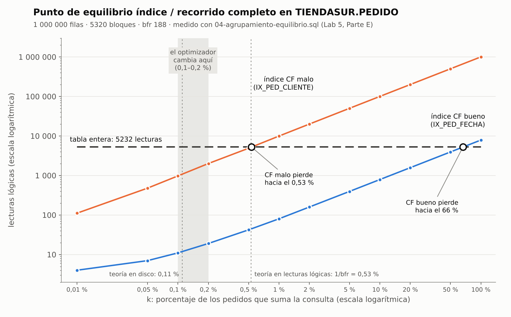

# Lab 5 · Oracle DBA Workflow II — Respuestas

- Nombre y apellidos: Vicente Losana Moreno
- Usuario en GitHub: vLosana
- Issue: Oracle DBA Workflow II: indexes measured with numbers, durability and recovery #8
- Fecha: 24 de noviembre de 2026

Todas las evidencias están en `docs/bitacora/lab5/evidencia/` (`script/`, `spool/` y `config/`).

## Notas sobre mi entorno

- `lab4-final`: 713 MB, 25 rutas dentro del volumen y ninguna fuera.
- La base empezó en ARCHIVELOG sin FRA (6 archivados, unos 730 MB, en `$ORACLE_HOME/dbs`). Tras la copia la pasé a NOARCHIVELOG y RMAN los borró (`…_00-noarchivelog.script.log`).
- Redo: 3 grupos de 200 MB (el PDF usa 2 de 20 MB). Por eso adapté el paso 4c de `10-redo.sql`.
- Sin `NLS_LANG` en el contenedor, las tildes salen como `??`. No afecta a las medidas.
- C##OPS_RO lee el alert log gracias a `scripts/lab4/11-ampliar-ops-ro.sql` (`…_00-ampliar-ops-ro.script.log`).

## Preguntas de comprobación

### 8.1. Punto de partida y banco de medida

**1. Compara el paso 6 de tu copia lab4-final con el de la copia lab3-final. ¿Qué demuestra la diferencia?**

Las dos copias dan 0 archivos fuera; la diferencia es la ruta. En `lab3-final` los 5 datafiles de negocio estaban en `…/dbhomeFree/dbs/`, dentro del volumen solo por un enlace simbólico. En `lab4-final` están en `/opt/oracle/oradata/FREE/FREEPDB1/`. Demuestra que la reubicación del Lab 4 funcionó.

Evidencia: `…_00-backup-lab4.script.log` (paso 6) e `inventario.txt` de `20261025T172711Z_lab3-final` y `20261027T181024Z_lab4-final`.

**2. Calcula el factor de bloqueo (bfr) de CLIENTE y de PEDIDO con sus estadísticas. ¿Por qué PEDIDO cabe casi el triple de filas por bloque?**

| Tabla | Filas (r) | Bloques (b) | Longitud media de fila | bfr = r / b |
|---|---|---|---|---|
| CLIENTE | 100 000 | 1517 | 102 bytes | 66 |
| PEDIDO | 1 000 000 | 5320 | 32 bytes | 188 |

CLIENTE: 100 000 / 1517 ≈ 66 filas por bloque; PEDIDO: 1 000 000 / 5320 ≈ 188. Caben casi el triple porque sus filas son 3,2 veces más cortas (32 bytes frente a 102). El bfr solo es 2,85 veces mayor porque cada fila ocupa además unos bytes fijos de control.

Evidencia: `…_01-perfil-tiendasur.script.log` (sección 1) y `…_01-reto-bfr.script.log`.

**3. ¿Por qué el banco de medida ejecuta cada sentencia dos veces y mide solo la segunda?**

La primera ejecución incluye el análisis (comprobar la sentencia y elegir el plan) y puede leer de disco. La segunda solo tiene el coste estable de la consulta, así que las medidas son comparables. En `prueba_pk`: 4 lecturas lógicas y 0 físicas.

Evidencia: `…_01-herramienta-medir.script.log` (`prueba_pk`).

### 8.1.1. Anatomía y tipos de índice

**4. Con tu evidencia 02: altura, número de hojas y factor de ramificación (fan-out) real de IX_PED_CLIENTE. ¿Qué altura tendría con mil millones de filas?**

Altura 3, 2216 hojas y 6 ramas. El fo real es (2216 + 6 − 1) / 6 ≈ 370, menor que el máximo de 543 porque las ramas no están llenas. Con 10⁹ filas serían unos 2,2 millones de hojas y altura 4 (5 lecturas por búsqueda): cada nivel multiplica por 543, así que con mil veces más filas solo sube un nivel.

Evidencia: `…_02-anatomia-indice.script.log` (sección 2 y tabla de proyección).

**5. En el volcado de la hoja de PK_CLIENTE, localiza una entrada y descompón el ROWID que guarda en bloque y fila. ¿Por qué no aparece el número de archivo?**

En `row#0` (clave `c1 02`, el cliente 1), el ROWID `00 00 03 1b 00 00` son 4 bytes de bloque (0x31B = 795) y 2 de ranura (0). No hay número de archivo porque `tbs_tiendasur` es BIGFILE: tiene un solo datafile.

Evidencia: `config/…_02-volcado-indice.trc.txt` (`row#0`) y `…_02-anatomia-indice.script.log` (cliente 1: bloque 795, ranura 0).

**6. Elige tres pruebas de la Parte D y explica, con las lecturas lógicas medidas, por qué un tipo de índice gana al otro.**

Q7: 15 lecturas con SORT → 7 con el compuesto (ya entrega el orden) → 3 con el cubriente (no va a la tabla), a cambio de 40 MB. Q14: 4073 → 528 con bitmap, porque BITMAP AND combina los filtros antes de ir a la tabla; solo vale si hay pocas escrituras. Q15: montículo + PK 4, IOT 3, hash 1, pero el hash leyó 2770 en un rango porque solo sirve para igualdad.

Evidencia: `…_03-tipos-indice.script.log` (lecturas de cada sección y tabla de la sección 8).

### 8.1.2. Agrupamiento, equilibrio y sargabilidad

**7. ¿Por qué IX_PED_FECHA tiene un clustering factor cercano al número de bloques e IX_PED_CLIENTE cercano al de filas? ¿Lo arreglaría un REBUILD?**

IX_PED_FECHA tiene CF 5220 (≈ bloques) porque los pedidos se cargaron en orden de fecha y las entradas vecinas caen en el mismo bloque. IX_PED_CLIENTE tiene 999 041 (≈ filas) porque el cliente es aleatorio. REBUILD no lo arregla: el CF depende del orden físico de la tabla, y solo puede haber uno.

Evidencia: `…_04-agrupamiento-equilibrio.script.log` (secciones 1 y 2).

**8. Según tu curva de la Parte E, ¿a partir de qué porcentaje deja de compensar cada índice? Compáralo con la fórmula de la Unidad 3.**

| Punto | Mi medida | Teoría |
|---|---|---|
| IX_PED_CLIENTE (CF malo) lee más que la tabla (≈ 5232) | entre el 0,5 % (4875) y el 1 % (9920), hacia el 0,53 % | 1/bfr = 1/188 = 0,53 % |
| El optimizador cambia a recorrido completo | entre el 0,1 % y el 0,2 % | (1/bfr)·(c_sec/c_aleat) = 0,53 % / 5 = 0,11 % |
| IX_PED_FECHA (CF bueno) lee más que la tabla | entre el 50 % (3938) y el 100 % (7875), hacia el 66 % | lee unas k/bfr hojas y bloques consecutivos |

El CF malo cruza hacia el 0,53 %, igual que 1/bfr, porque visita un bloque por fila. El optimizador cambia antes (0,1–0,2 %) porque la lectura aleatoria le cuesta 5 veces más que la secuencial. El CF bueno solo pierde hacia el 66 %, cuando ya lee la tabla y el índice enteros.

Evidencia: `…_04-agrupamiento-equilibrio.script.log` (sección 3) y `docs/bitacora/lab5/curva-equilibrio.png`.

**9. Explica por qué Q4b ('Gonz%') usa el índice y aun así lee más bloques que un recorrido completo.**

Usa el índice porque 'Gonz%' es sargable: es un rango por el principio de la cadena. Lee más (2024 frente a unas 1523) porque devuelve el 2,1 % de los clientes con CF malo, y el umbral de CLIENTE es 1/66 ≈ 1,5 %.

Evidencia: `…_05-sargabilidad.script.log` (regla 4).

### 8.1.3. Coste de escritura y mantenimiento

**10. Con tu evidencia 06: bloques modificados por INSERT con 4, 9 y 5 índices. ¿Qué índices de la propuesta del compañero rechazaste y con qué dato?**

| Escenario | Índices en PEDIDO | INSERT | UPDATE estado | UPDATE importe | DELETE |
|---|---|---|---|---|---|
| Hoy | 4 | 10,1 | 2 | 6 | 10,1 |
| Propuesta del compañero | 9 | 20,2 | 6 | 6 | 20,1 |
| V005 | 5 | 12,1 | 8,1 | 6 | 10,1 |

INSERT: 10,1 / 20,2 / 12,1 bloques, unos 2 más 2 por índice, así que la propuesta duplica el coste. Rechacé IX_PED_CANAL (sin uso, 33 % por valor), IX_PED_FEC_CLI (sin uso; IX_PED_FECHA es su prefijo), IX_PED_ESTADO (25 % por valor; para Q12 basta un parcial de 54 hojas) e IX_PED_CLI_FEC (el cubriente da 3 lecturas frente a 7). Acepté IX_PED_CP (Q3: 106 lecturas, 0,009 % por valor).

Evidencia: `…_06-indices.script.log` («por fila: N bloques» y las cinco preguntas del protocolo).

**11. Distingue, con tus gráficos de la Parte H, un índice con divisiones 50/50, uno con divisiones 90/10 y uno con patrón cola.**

IX_AZAR (50/50): 595 divisiones, hojas al 75,4 %, mapa de `=` y `-`. IX_CRECIENTE (90/10): 398 divisiones, hojas al 99,9 %, mapa todo `#`. IX_COLA: izquierda vacía y derecha llena (224 hojas vacías), porque se inserta por un lado y se borra por el otro.

Evidencia: `…_07a-crecimiento.script.log` y gráficos `…_07a-grafico-IX_AZAR`, `…_07a-grafico-IX_CRECIENTE` y `…_07b-grafico-IX_COLA-antes`.

**12. ¿Qué remedio elegirías para el patrón cola en producción, en horario de servicio, y por qué?**

| Paso | Hojas | MB del segmento | «Siguiente mensaje» |
|---|---|---|---|
| Cola degradada | 425 | 4 | 226 lecturas (1 raíz + 224 hojas vacías + 1) |
| COALESCE | 201 | 4 | 2 |
| SHRINK SPACE | 201 | 1,69 | 2 |
| REBUILD ONLINE | 223 | 2 | 2 |

COALESCE: en línea y sin bloqueos, baja de 226 a 2 lecturas, aunque no devuelve espacio. SHRINK SPACE si además quiero recuperarlo (1,69 MB). REBUILD necesita el doble de espacio y mucho redo. La solución de fondo es particionar por fecha.

Evidencia: `…_07c-remedios.script.log`.

### 8.1.4. SCN, control files, redo y FRA

**13. Con tu evidencia 08: ¿qué valores compara Oracle al abrir para decidir si hace falta recuperación?**

Compara el SCN de checkpoint del control file (`v$datafile`) con el de la cabecera de cada datafile (`v$datafile_header`): 5 529 070 en los dos, y 5 537 166 tras el checkpoint. Si coinciden y el cierre fue limpio, abre sin recuperación. PDB$SEED se queda en 2 098 101 por ser de solo lectura.

Evidencia: `…_08-scn-checkpoint.script.log` (secciones 2 y 3).

**14. ¿Qué protege la multiplexación del control file en el mismo volumen y qué no? ¿Cómo se haría en producción?**

Protege de perder o corromper una copia (simulacro B: reparado en ≈ 1,9 s copiando otra), pero no de perder el volumen, porque las tres están en `/opt/oracle/oradata/FREE/`. En producción: cada copia en un disco distinto (o ASM) y CONTROLFILE AUTOBACKUP ON en RMAN.

Evidencia: `…_09-multiplexar-controlfile.script.log` (tres copias en `v$controlfile`).

**15. Explica los estados CURRENT, ACTIVE e INACTIVE con tu evidencia 10 y por qué Oracle rechaza los tres borrados del paso 4.**

CURRENT: LGWR escribe en él. ACTIVE: sus cambios aún no están todos en los datafiles. INACTIVE: ya no hace falta y se puede reutilizar. En mi tercer cambio: 1 ACTIVE, 2 CURRENT, 3 INACTIVE. Oracle no deja borrar el CURRENT (4a, ORA-01623) ni quitarle un miembro (4b, ORA-01609), y exige al menos 2 grupos (4c, ORA-01567); con mis 3 grupos el 4c no fallaría, por eso lo omití.

Evidencia: `…_10-redo.script.log` (sección 4) y `…_10-tercer-cambio.script.log`.

**16. Describe la cadena de causas del escenario de la FRA llena, desde ORA-19815 hasta que la base deja de aceptar cambios.**

FRA sin espacio → ORA-19815 (aviso) → ARCn falla con ORA-19809 y ORA-16038 (log 1, secuencia 19) → el grupo queda sin archivar y LGWR no puede reutilizarlo → sin grupos libres, las sesiones esperan en «log file switch (archiving needed)» y las conexiones nuevas dan ORA-00257. En mi caso no llegó a colgarse porque el grupo 3 ya estaba archivado.

Evidencia: `…_11-fra-llena.script.log` (pasos 3 a 5).

### 8.1.5. Undo, WAL y simulacros

**17. Explica, con los pasos 1 a 4 de tu evidencia 12, la frase "lectores no bloquean a escritores".**

B leyó ACTIVO sin esperar aunque A había cambiado la fila, porque Oracle le reconstruyó la versión confirmada con el undo (segmento 9). A tenía TM modo 3 y TX modo 6, y B solo chocó al intentar bloquear la misma fila (ORA-00054, transacción 9.5.799). Solo se bloquean dos escritores.

Evidencia: `…_12-lectura-consistente.script.log` (pasos 1 a 4).

**18. ¿Por qué un DELETE genera más undo que un INSERT? ¿Por qué el ROLLBACK también genera redo?**

| Operación (10 000 filas) | Bloques de undo | Undo (KB) | Redo (KB) | …del cual describe el undo (KB) | Redo del ROLLBACK (KB) |
|---|---|---|---|---|---|
| INSERT | 140 | 1120 | 4857 | 2044 | 358 |
| UPDATE (canal) | 71 | 568 | 1258 | 540 | 751 |
| DELETE | 427 | 3416 | 6627 | 3262 | 4701 |

Deshacer un INSERT es solo borrar la fila; deshacer un DELETE exige guardar la fila entera y sus entradas en los 5 índices: 3416 KB de undo frente a 1120. El ROLLBACK genera redo (4701 KB en el DELETE) porque aplica cambios inversos a los bloques, y todo cambio se protege con redo.

Evidencia: `…_12-undo-y-redo.script.log` (sección 1).

**19. Con tu evidencia 13: ¿dónde está la garantía de durabilidad justo después del COMMIT? ¿Y después del checkpoint?**

| Paso | Redo (KB) | Escrituras de LGWR | Bloques escritos por DBWn | Bloques sucios de la tabla |
|---|---|---|---|---|
| UPDATE de 20 000 filas + COMMIT | 1779 | 3 | 0 | 231 |
| ALTER SYSTEM CHECKPOINT | 8 | 1 | 349 | 0 |

Tras el COMMIT, en el redo log online: LGWR escribió 1779 KB y DBWn 0 bloques (231 sucios en memoria). Tras el checkpoint, también en los datafiles: DBWn escribió 349 bloques y quedan 0 sucios.

Evidencia: `…_13-lgwr-dbwn.script.log`.

**20. Simulacro A: explica roll forward y roll back con las filas 102 y 103 y las líneas del alert log.**

Antes del SHUTDOWN ABORT, la 102 se cambió con COMMIT y la 103 sin COMMIT. Al arrancar, SMON hizo roll forward desde el checkpoint («read 18 KB redo, 27 data blocks need recovery») y luego roll back con el undo: la 102 se quedó EGRESADO y la 103 volvió a ACTIVO. RTO ≈ 1,6 s, RPO 0.

Evidencia: `…_14a-caida-instancia.script.log` y `…_14a-tiempos-alert.script.log`.

**21. Simulacros C y D: tu RTO y tu RPO en cada uno. ¿Por qué son tan distintos?**

C: RTO 48 s y RPO 1 s (artificial, porque la copia era de justo antes); restauré la base entera (778 MB) por una tabla. D: RTO 9 s y RPO 0; solo se restauró un archivo y el redo lo puso al día (la fila 104 sobrevivió). El RTO de C crece con el tamaño de la base y el de D, con el daño.

Evidencia: `…_14c-simulacro-restauracion.script.log` y `…_14d-perdida-datafile.script.log`.

**22. Clasifica cada error ORA- del bloque 5 de tu runbook: incidente real, efecto del laboratorio o ruido conocido.**

Ningún incidente real. ORA-63999, ORA-01110 y ORA-01113 (22:51): efecto del laboratorio, el simulacro D (borré `academia01.dbf` y Oracle cerró y reabrió FREEPDB1). ORA-00800 de LGWR (22:49): ruido conocido del contenedor, igual que en el Lab 4.

Evidencia: `spool/…_15-healthcheck.spool.log` (bloque 5).

## Simulacro de examen 1Z0-182

**S1.** B. Parte E. CF ≈ filas: un bloque distinto por fila (IX_PED_CLIENTE, 999 041).

**S2.** A y C. Parte F. Indexar la expresión o aplicar la función al dato (Q1: 1486 → 4).

**S3.** B. Parte F. TO_NUMBER sobre la columna anula el índice (5232 → 106 con cadena).

**S4.** B. Parte D. Pocos valores y carga nocturna (Q14: 4073 → 528).

**S5.** B. Parte D. Pocos valores en la primera columna (Q6: skip scan, 144).

**S6.** B. Parte G. Se sigue manteniendo y se vuelve atrás con VISIBLE (IX_PED_IMPORTE).

**S7.** A y C. Parte H. Los dos en línea (COALESCE 226 → 2; SHRINK 1,69 MB).

**S8.** B. Parte H. Reparte las inserciones, pero el rango leyó 878 frente a 4.

**S9.** C. Parte G. Sin índice solo se toca la tabla (UPDATE estado: 2 bloques).

**S10.** B. Parte C. fo máximo 543 → altura 3 con 10⁶ filas y 4 con 10⁹.

**S11.** A y C. Parte D. La fila está en el índice (Q15: IOT 3 frente a 4).

**S12.** B. Parte I. 5 529 070 en `v$datafile` y en `v$datafile_header`.

**S13.** C. Parte I. CKPT anota el checkpoint; DBWn escribe los bloques.

**S14.** B y E. Parte O (simulacro B). Sin control file no hay `v$database` ni `v$logfile`.

**S15.** B. Parte L. Se activa en MOUNT.

**S16.** B. Parte K. INACTIVE y archivado: basta con recrearlo.

**S17.** A y C. Parte M. Lectura consistente y AS OF TIMESTAMP.

**S18.** B. Parte M. 2044 de 4857 KB de redo describían el undo.

**S19.** A. Parte N. LGWR ya escribió; DBWn, 0 bloques.

**S20.** A. Parte I. Más checkpoints, menos redo que aplicar al arrancar.

**S21.** B. Parte L. LGWR espera un grupo que no se ha podido archivar.

**S22.** B. Parte O (simulacro D). OFFLINE aísla el daño y el resto sigue en servicio.

**S23.** B. Parte O. SYSTEM no admite OFFLINE: se repara en MOUNT.

**S24.** B. Parte O (simulacro C). Solo queda la copia; se pierde lo posterior.

**S25.** B y D. Parte M. Falta de undo: más retención y GUARANTEE.

**S26.** A. Parte L. Uso de la FRA por tipo de archivo.

## Game day: RTO y RPO de los cuatro simulacros

| Simulacro | Fallo | Mecanismo | RTO medido | RPO real | Qué me sorprendió | Qué cambiaría |
|---|---|---|---|---|---|---|
| A | Caída de la instancia (SHUTDOWN ABORT) | Recuperación de instancia (SMON) | ≈ 1,6 s (recuperación: 52 ms) | 0 | Bastó un STARTUP (52 ms de recuperación). | Contar también el tiempo de detección. |
| B | Pérdida de control03.ctl | Copia de una copia sana | ≈ 1,9 s (≈ 5,8 s contando la parada) | 0 | El error dice qué copia falta. | Copias en discos distintos. |
| C | DROP TABLE … PURGE | Restauración completa (778 MB) | 48 s | 1 s (artificial) | 778 MB para una sola tabla. | Copias más frecuentes. |
| D | Pérdida del datafile de TBS_ACADEMIA | RMAN RESTORE + RECOVER | 9 s (8 s de reparación) | 0 | Oracle cerró toda la PDB (ORA-63999). | Seguir el runbook hasta ver READ WRITE. |

## Retrospectivas

### Incidente: FRA llena (Parte L)

- Impacto: ninguna pérdida; grupos 1 y 2 sin archivar, sin cuelgue.
- Detección: ORA-16038 y ORA-19809 en la sesión, ORA-19815 en el alert log.
- Causa raíz: el límite de la FRA bajado a 2 MB.
- Mitigación: devolver los 4 GB; ARCn reintentó solo.
- Qué cambia: alertar al 80 % de la FRA (bloque 3 del runbook).
- Lección: ORA-19815 avisa antes del bloqueo; el tercer grupo de redo evitó el cuelgue.

### Game day (Parte O)

- Qué salió como esperaba: ningún dato confirmado perdido; A y B en menos de 2 s.
- Qué no: el C se paró a mitad de la copia (proceso suspendido, reanudado con `fg`) y en el D cayó la PDB entera (ORA-63999).
- Mejora concreta al procedimiento: seguir `docs/runbooks/perdida-datafile.md` y medir el RTO desde la detección.

## Retos de práctica profesional

| Parte | Reto | Dónde está |
|---|---|---|
| B | bfr de PEDIDO bloque a bloque con DBMS_ROWID | `scripts/lab5/01-reto-bfr.sql` y su evidencia `_01-reto-bfr` |
| C | Altura de UX_CLI_EMAIL calculada, medida y dibujada | `scripts/lab5/02-reto-email.sql` y sus evidencias `_02-reto-email` y `_02-grafico-UX_CLI_EMAIL` |
| D | ¿Q9 con un índice cubriente? | `scripts/lab5/03-reto-q9.sql` y su evidencia `_03-reto-q9` |
| E | Curva del punto de equilibrio | `docs/bitacora/lab5/curva-equilibrio.png` |
| O | Runbook de pérdida de datafile | `docs/runbooks/perdida-datafile.md` |

- B: 5220 bloques con filas, media 191,6.
- C: 501 hojas y fo máximo ≈ 441 → 3 ramas y altura 3.
- D: Q9 cuesta 5 lecturas; un cubriente sería otra tabla de 42 MB: no compensa.
- E: explicado en la pregunta 8.
